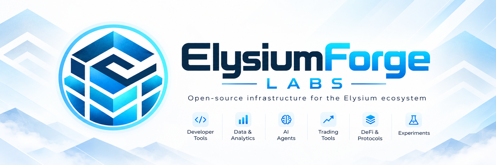

# ElysiumForge Labs

Open tooling and a build partner for **Elysium** — Kinetiq’s Arbitrum Orbit L2 on Hyperliquid / HyperEVM.

We help developers ship faster, clients launch production products, and investors evaluate opportunity on Elysium — with public kits, technical support, and custom delivery when you need more than a fork.

---

## Who we support

| Audience | How we help |
| --- | --- |
| **Developers** | Starter kits, SDKs, CLIs, MCP servers, benchmarks, and clear docs you can fork and extend |
| **Clients & product teams** | Technical support and custom builds mapped to your roadmap |
| **Investors & researchers** | Open repositories, market tooling, and latency / fee evidence to study the stack |

---

## What we build

**Support & delivery**

- Technical guidance for Elysium, Ascend, HyperEVM / HyperCore paths
- Custom project design and implementation with your team

**Utility products & open kits**

| Area | Examples in this org |
| --- | --- |
| Token launchpads | [ascend-launchpad-kit](https://github.com/ElysiumForge-Labs/ascend-launchpad-kit) · [elysium-neuriio-launchpad](https://github.com/ElysiumForge-Labs/elysium-neuriio-launchpad) · [elysium-keel-app](https://github.com/ElysiumForge-Labs/elysium-keel-app) · [elysium-keel-contracts](https://github.com/ElysiumForge-Labs/elysium-keel-contracts) |
| DEX & markets | [elysium-dex](https://github.com/ElysiumForge-Labs/elysium-dex) · [elysium-ropes-market](https://github.com/ElysiumForge-Labs/elysium-ropes-market) · [elysium-market-dashboard](https://github.com/ElysiumForge-Labs/elysium-market-dashboard) |
| Bridges & HyperCore | [hypercore-price-bridge](https://github.com/ElysiumForge-Labs/hypercore-price-bridge) · [elysium-hypercore-console](https://github.com/ElysiumForge-Labs/elysium-hypercore-console) |
| AI agents & tooling | [elysium-chain-mcp](https://github.com/ElysiumForge-Labs/elysium-chain-mcp) · [elysium-builder-skill](https://github.com/ElysiumForge-Labs/elysium-builder-skill) · [elysium-agent-harness](https://github.com/ElysiumForge-Labs/elysium-agent-harness) · [elysium-atlas-app](https://github.com/ElysiumForge-Labs/elysium-atlas-app) · [elysium-atlas-backend](https://github.com/ElysiumForge-Labs/elysium-atlas-backend) · [elysium-objective-agent](https://github.com/ElysiumForge-Labs/elysium-objective-agent) · [elysium-emotion-engine](https://github.com/ElysiumForge-Labs/elysium-emotion-engine) |
| Wallets & bots | [elysium-android-wallet](https://github.com/ElysiumForge-Labs/elysium-android-wallet) · [elysium-activity-bot](https://github.com/ElysiumForge-Labs/elysium-activity-bot) · [elysium-yield-aggregator](https://github.com/ElysiumForge-Labs/elysium-yield-aggregator) |
| Smart contracts & infra | [elysium-testnet-toolkit](https://github.com/ElysiumForge-Labs/elysium-testnet-toolkit) · [elysium-latency-benchmark](https://github.com/ElysiumForge-Labs/elysium-latency-benchmark) |

Tokens, NFTs, games, trading bots, and contract systems are in scope for custom work; the table above is what is public today.

---

## Featured repositories

| Repository | Focus |
| --- | --- |
| [elysium-dex](https://github.com/ElysiumForge-Labs/elysium-dex) | Uniswap V2 AMM for Elysium testnet |
| [elysium-keel-app](https://github.com/ElysiumForge-Labs/elysium-keel-app) | Launch → graduate → Hyperliquid Core |
| [ascend-launchpad-kit](https://github.com/ElysiumForge-Labs/ascend-launchpad-kit) | Ascend SDK, indexer, CLI, and bot |
| [elysium-chain-mcp](https://github.com/ElysiumForge-Labs/elysium-chain-mcp) | MCP server for AI agents on Elysium |
| [elysium-android-wallet](https://github.com/ElysiumForge-Labs/elysium-android-wallet) | Native Android wallet (Koro) |
| [elysium-latency-benchmark](https://github.com/ElysiumForge-Labs/elysium-latency-benchmark) | Inclusion latency & gas: Elysium vs HyperEVM |

Browse the full catalog: [github.com/ElysiumForge-Labs](https://github.com/ElysiumForge-Labs).

---

## How we work

1. **Open by default** — practical repos with readable docs; fork, measure, and ship.
2. **Support when stuck** — technical help for builders integrating Elysium.
3. **Custom when needed** — launchpads, agents, wallets, DEX/bridges, games, contracts, bots, and tools tailored to your product.

Testnet → mainnet. Clear interfaces. Production-minded delivery.

---

## Let’s build on Elysium

Open an issue on a relevant repository, or reach out through the org if you need support, a custom build, or help evaluating opportunity on Elysium.

**ElysiumForge Labs** — tooling and partnership to make Elysium more capable and useful for builders, clients, and investors.
